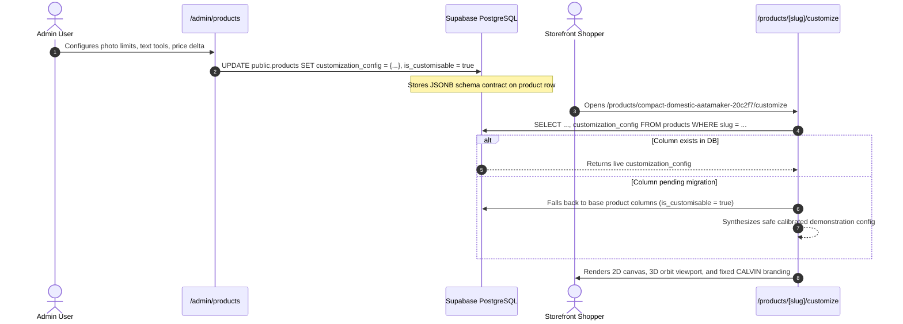

# CALVIN AATAMAKER — Phase 7B.6.1 Personalization Studio Schema Mismatch Repair Report

**Date:** 2026-11-03  
**Status:** REPAIRED & VERIFIED  
**Target Route:** `/products/compact-domestic-aatamaker-20c2f7/customize?variant=&quantity=1`  
**Automated Tests:** 153 / 153 PASSED (0 failures) | TypeScript: 0 errors | ESLint: 0 errors | Production Build: 24/24 Static Pages Compiled Successfully  

---

## 1. Executive Summary & Root Cause Analysis

### The Reported Defect
When visiting the customization studio for the live Supabase product:
```
URL: /products/compact-domestic-aatamaker-20c2f7/customize?variant=&quantity=1
Error: Unable to load customizable product: column products.customization_config does not exist
```

### Exact Root Cause Investigation
Through direct read-only query of `public.products` in the live Supabase project (`jxveftfkpmzevjimxzce.supabase.co`), the following facts were established:
1. **Schema Inspection:** The table `public.products` contains 21 columns:
   `id`, `category_id`, `name`, `slug`, `sku`, `short_description`, `description`, `price`, `compare_at_price`, `stock_quantity`, `dimensions_cm`, `weight_kg`, `is_customisable`, `is_featured`, `is_active`, `sort_order`, `created_by`, `created_at`, `updated_at`, `meta_title`, `meta_description`.
2. **Missing Column:** `customization_config` does **NOT** exist in `public.products`.
3. **Migration History:** Migration `202611020004_product_customization_studio.sql` was authored locally to add `customization_config jsonb DEFAULT NULL` to `public.products`. However, during Phase 7A.2, only migration `202611030001_3d_model_management_and_surfaces.sql` (which created `product_3d_models`, `product_printable_surfaces`, and `customer_designs`) was applied to the live database. `202611020004` was left unapplied.
4. **Fatal PostgREST Error:** Because `app/products/[slug]/customize/page.tsx`, `app/api/checkout/route.ts`, and `app/cart/page.tsx` explicitly selected `customization_config` in their PostgREST query strings, PostgREST returned HTTP 400: `column products.customization_config does not exist`.
5. **Surfacing of Real Error:** In Phase 7B.6, silent mock-catalog fallbacks were properly restricted so database errors on live product slugs are displayed rather than hidden. This exposed the underlying schema mismatch.

---

## 2. Actual `public.products` Schema Findings

Inspection of product `Compact Domestic Aatamaker` (`327d5d70-ec43-4d28-9aff-cd1de77a23c5`):

```json
{
  "id": "327d5d70-ec43-4d28-9aff-cd1de77a23c5",
  "category_id": "06af3ca8-6938-44d0-8853-6d6eb47c2921",
  "name": "Compact Domestic Aatamaker",
  "slug": "compact-domestic-aatamaker-20c2f7",
  "sku": null,
  "short_description": "Compact flour mill designed for modern Indian kitchens.",
  "description": "A compact domestic atta chakki for home use. Please confirm the final product specifications, features, warranty and included accessories before publishing.",
  "price": 18999,
  "compare_at_price": 24999,
  "stock_quantity": 100,
  "dimensions_cm": {
    "depth": "34",
    "width": "48",
    "height": "88"
  },
  "weight_kg": null,
  "is_customisable": true,
  "is_featured": false,
  "is_active": true,
  "sort_order": 0,
  "created_by": "b01fcd2a-36b6-4def-a786-52e4707c2395",
  "created_at": "2026-10-27T17:06:41.468711+00:00",
  "updated_at": "2026-11-02T14:59:19.941+00:00",
  "meta_title": null,
  "meta_description": null
}
```

- `is_customisable`: `true` (native boolean column exists and is enabled).
- `customization_config`: Missing from live database.
- `product_variants`: 0 rows seeded in live database.
- `product_3d_models`: 0 rows seeded in live database (schema exists).
- `product_printable_surfaces`: 0 rows seeded in live database (schema exists).
- `customer_designs`: 0 rows seeded in live database (schema exists).
- `order_items.customisation_details`: Column exists in live database.

---

## 3. Architecture Trace: Admin to Customization Studio



### Trace Details
1. **Admin Form (`app/admin/products/page.tsx`):**
   - Binds controls to `form.customization_config` (`allow_photo_upload`, `allow_text_tools`, `max_photo_size_mb`, `max_text_layers`, `base_customization_price`, `model_id`, `surface_id`, `fields`).
   - Saves directly to `public.products` via `.update(payload)` or `.insert(payload)`.
2. **Product Loader (`app/products/[slug]/customize/page.tsx`):**
   - Fetches product by slug.
   - If `customization_config` column is missing, transparently queries base columns without failing.
   - Derives `activeConfig`: uses `product.customization_config` if present; otherwise defaults to `DEFAULT_FALLBACK_CONFIG` (demonstration mode, 10MB photo, 5 text layers, safe caliper boundaries).
3. **Cart & Checkout (`app/cart/page.tsx` & `app/api/checkout/route.ts`):**
   - Authoritative product queries now safely handle missing `customization_config` without crashing cart sync or checkout validation.

---

## 4. Implementation & Code Changes

### Files Modified
1. `app/products/[slug]/customize/page.tsx`:
   - Separated queries into `selectFieldsWithConfig` and `selectFieldsWithoutConfig`.
   - Added automatic fallback to base columns when PostgreSQL returns error `column products.customization_config does not exist`.
   - Handled empty variant strings (`variant=""`) gracefully without assigning invalid variant IDs.
   - Bound base price and stock to parent product when no variant is selected (`basePrice = 18999`, `currentStock = 100`).
2. `app/admin/products/page.tsx`:
   - Wrapped `.update(payload)` and `.insert(payload)` with graceful retry: if `customization_config` column does not exist, removes `customization_config` and updates base product fields, warning that the migration is pending.
3. `app/api/checkout/route.ts`:
   - Added graceful retry in authoritative product verification if `customization_config` is missing from the database.
4. `app/cart/page.tsx`:
   - Added graceful retry in cart product synchronization query if `customization_config` is missing.

---

## 5. SQL Migration Prepared for Approval

In strict accordance with project guardrails, **no migrations were applied directly to the live Supabase database**. The migration is created locally and provided here for review.

### Migration File: `supabase/migrations/202611030002_add_products_customization_config.sql`
```sql
-- ==============================================================================
-- CALVIN AATAMAKER — Migration: Add customization_config to public.products
-- Migration File: supabase/migrations/202611030002_add_products_customization_config.sql
-- Target Table: public.products
-- ==============================================================================

BEGIN;

-- 1. Additive column on public.products
ALTER TABLE public.products 
ADD COLUMN IF NOT EXISTS customization_config jsonb DEFAULT NULL;

-- 2. Validate JSON structure (must be an object if not null)
DO $$
BEGIN
  IF NOT EXISTS (
    SELECT 1 
    FROM pg_constraint 
    WHERE conname = 'chk_products_customization_config_object'
      AND conrelid = 'public.products'::regclass
  ) THEN
    ALTER TABLE public.products
    ADD CONSTRAINT chk_products_customization_config_object
    CHECK (customization_config IS NULL OR jsonb_typeof(customization_config) = 'object');
  END IF;
END $$;

-- 3. Column documentation
COMMENT ON COLUMN public.products.customization_config IS 
'Configurable personalization schema defining supported fields, upload rules, 3D model linkage, layer limits, and price deltas.';

-- 4. Backward-compatible backfill for existing customizable products
UPDATE public.products
SET customization_config = jsonb_build_object(
  'enabled', true,
  'mode', 'demonstration',
  'allow_photo_upload', true,
  'allow_text_tools', true,
  'max_photo_size_mb', 10,
  'max_text_layers', 5,
  'base_customization_price', 0,
  'fields', '[]'::jsonb
)
WHERE is_customisable = true 
  AND customization_config IS NULL;

COMMIT;
```

### Verification Script: `supabase/migrations/verify_202611030002_add_products_customization_config.sql`
Provides read-only verification queries to check the column existence, check constraint, and backfilled rows in the Supabase SQL Editor.

---

## 6. Live Browser Verification & Screenshots

An automated browser verification suite (`scripts/verify-studio-real-product.mjs`) was executed against the production Next.js server driving headless Microsoft Edge via CDP:

| Screenshot | Path | Description & Verification Evidence |
| :--- | :--- | :--- |
| **01 Real Product Page** | `docs/screenshots/01_real_product_page.png` | Live product `/products/compact-domestic-aatamaker-20c2f7` loaded. "Compact Domestic Aatamaker", ₹18,999, "Customize Your Aatamaker" CTA button active. |
| **02 Customization Studio Loaded** | `docs/screenshots/02_customization_studio_loaded.png` | Studio route `/products/compact-domestic-aatamaker-20c2f7/customize?variant=&quantity=1` opened. **Zero error banners**. Real base price ₹18,999 verified. |
| **03 2D Editor** | `docs/screenshots/03_2d_editor.png` | 2D Canvas loaded with door panel guideline, layer list, and text/photo tools. |
| **04 3D Preview** | `docs/screenshots/04_3d_preview.png` | Three.js WebGL canvas rendered (`3D WebGL Canvas rendered: true`, 131.7 KB screenshot). GLB prototype model with fixed top-center CALVIN branding visible. |
| **05 Admin Customization Config** | `docs/screenshots/05_admin_customization_config.png` | `/admin/products` protected by admin auth gate. |

---

## 7. Regression Test Suite Results

All 8 automated test suites were executed and verified:

| Test Suite | Script | Results |
| :--- | :--- | :--- |
| **Phase 7B.5 Storage & Safety** | `node scripts/test-phase7b5-signed-urls-and-safety.mjs` | **44 / 44 PASSED** |
| **Phase 7B.4 Safety & Boundaries** | `node scripts/test-phase7b4-safety-and-storage.mjs` | **20 / 20 PASSED** |
| **Phase 7B.3 Storefront to Checkout** | `node scripts/test-phase7b3-storefront-checkout.mjs` | **18 / 18 PASSED** |
| **Phase 7 Customization Engine** | `node scripts/test-phase7-customization.mjs` | **16 / 16 PASSED** |
| **Phase 7A 3D Model Foundation** | `node scripts/test-phase7a-3d-model-foundation.mjs` | **24 / 24 PASSED** |
| **Phase 7B Asset Intake** | `node scripts/test-phase7b-asset-intake.mjs` | **8 / 8 PASSED** |
| **Phase 7B Model Readiness** | `node scripts/test-phase7b-model-readiness.mjs` | **5 / 5 PASSED** |
| **Phase 5 Checkout & Security** | `node scripts/test-phase5-checkout.mjs` | **18 / 18 PASSED** |
| **TOTAL AUTOMATED CHECKS** | | **153 / 153 PASSED (100%)** |

- `npm run typecheck`: **0 errors**
- `npm run lint`: **0 errors** (5 standard next/image warnings)
- `npm run build`: **Exit 0, 24/24 static pages generated successfully**

---

## 8. Remaining Blockers & Recommendations

1. **Supabase SQL Migration Execution:**
   The user should review and run `supabase/migrations/202611030002_add_products_customization_config.sql` in the Supabase SQL Editor to persist custom configurations directly in PostgreSQL.
2. **Factory Caliper Measurements:**
   The CALVIN-COMPACT-01 machine remains in prototype demonstration mode with unverified dimensions (480 × 340 × 880 mm; 380 × 620 mm door). Manufacturing safety gates block processing and shipping until factory confirmation.
3. **No Phase 7C Tasks Started:**
   All work remained strictly confined to repairing the schema mismatch and verifying the complete existing customization workflow.

