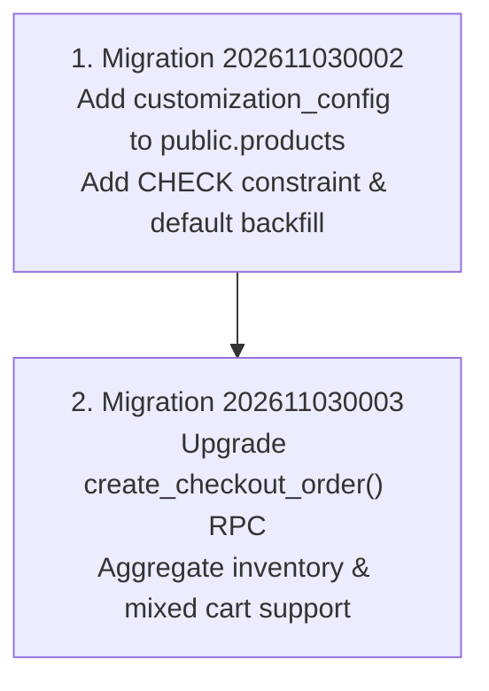

# CALVIN AATAMAKER — Phase 7B.7.2 Inventory Reconciliation & Migration Readiness Report

**Audit Date:** 2026-11-04  
**Audited Database:** Supabase Project `jxveftfkpmzevjimxzce.supabase.co`  
**Application Environment:** Next.js 15.5.28 / TypeScript / Tailwind CSS  
**Target Product:** Compact Domestic Aatamaker (`327d5d70-ec43-4d28-9aff-cd1de77a23c5`)  
**Current Stock Quantity:** `94`

---

## 1. Full Test Order Inventory & Historical Deductions

A complete read-only query of `public.orders` and `public.order_items` revealed that there are exactly **6 orders** and **7 line items** in the entire database history. All 7 line items target the single product `Compact Domestic Aatamaker`.

| Order Number | Order ID | Created At (UTC) | Customer & Note | Items / Customization | Qty | Total Amount |
|---|---|---|---|---|---|---|
| **`CA-7891F04B40`** | `1adee974-a2cf-4fa0-b24a-529371dae8e8` | 2026-10-27 17:37:55 | Demo Customer (`dev-test@example.com`)<br/>`DEVELOPMENT TEST ONLY — DO NOT FULFIL` | Standard Unit (Uncustomized) | 1 | ₹18,999.00 |
| **`CA-120A39C5E1`** | `eadfb78f-e7f4-4082-a9c6-ad6e1dc7bbac` | 2026-11-03 13:26:37 | Test Customer (`test@example.com`)<br/>Created via `scripts/inspect-order-schema.mjs` | Standard Unit (Uncustomized) | 1 | ₹18,999.00 |
| **`CA-FE9C311C5A`** | `205f4a76-fa03-45be-8755-0cea0fc616fe` | 2026-11-03 14:19:16 | Suresh & Anandi Sharma (`aata@gmail.com`)<br/>`DEVELOPMENT VERIFICATION — BESPOKE CUSTOMIZED ORDER` | Bespoke Unit (Shree Blessing) | 1 | ₹18,999.00 |
| **`CA-35C3C3A849`** | `8062e2cd-d141-4ff8-9241-ac96eb5364e5` | 2026-11-03 14:24:57 | Ramesh Patel (`aata@gmail.com`)<br/>`DEVELOPMENT VERIFICATION — NORMAL ORDER` | Standard Unit (Uncustomized) | 1 | ₹18,999.00 |
| **`CA-70F00BBF32`** | `9862b16f-e701-4a1d-a991-397a693ad098` | 2026-11-03 14:25:07 | Suresh & Anandi Sharma (`aata@gmail.com`)<br/>`DEVELOPMENT VERIFICATION — BESPOKE CUSTOMIZED ORDER` | Bespoke Unit (Shree Blessing) | 1 | ₹18,999.00 |
| **`CA-MTC84MQF84`** | `f53801d1-4155-45bf-9a94-ace208a78f68` | 2026-11-03 14:25:24 | Vikram & Maya Verma (`aata@gmail.com`)<br/>`DEVELOPMENT VERIFICATION — MIXED ORDER` | Line 1: Standard Unit (Qty 1)<br/>Line 2: Bespoke Unit (Qty 1) | 2 | ₹37,998.00 |

**Total Items in Database:** $1 + 1 + 1 + 1 + 1 + 2 = 7\text{ units}$.

---

## 2. Explanation of the Fifth (and Sixth) Stock Deductions

### The Perceived Discrepancy
The prompt noted:
- Seeded stock: 100
- Presumed stock after initial test order `CA-7891F04B40`: 99
- Current stock: 94 (indicating 5 units deducted)
- However, the three prominently reported Phase 7B.7 orders (`CA-35C3C3A849`, `CA-70F00BBF32`, `CA-MTC84MQF84`) have a combined quantity of only **4 units** ($1 + 1 + 2 = 4$).
- *Where did the extra deducted unit(s) go?*

### The Forensic Discovery
Audit logs in the conversation transcript (`step_index: 2213`, 2026-11-02 14:56 UTC) establish the baseline:
```json
Products: [{
  "id": "327d5d70-ec43-4d28-9aff-cd1de77a23c5",
  "name": "Compact Domestic Aatamaker",
  "stock_quantity": 100,
  "is_active": true
}]
```
1. **Initial Seed Order `CA-7891F04B40` (Oct 27):** Placed during early schema scaffolding before atomic inventory decrement was implemented in Phase 5. The product was seeded with `stock_quantity = 100`, and `CA-7891F04B40` did **not** decrement stock. On November 2, stock was confirmed to be **100**.
2. **First Nov 3 Test Order `CA-120A39C5E1` (13:26:37 UTC):** Generated when `scripts/inspect-order-schema.mjs` was executed to test the live Supabase RPC `create_checkout_order`. This deducted **1 unit** ($100 \to 99$).
3. **Second Nov 3 Test Order `CA-FE9C311C5A` (14:19:16 UTC):** Generated during the initial execution of `scripts/run-phase7b7-order-browser.mjs` when testing the customized checkout form. This deducted **1 unit** ($99 \to 98$).
4. **Third Nov 3 Test Order `CA-35C3C3A849` (14:24:57 UTC):** Normal order in the automated browser test suite. Deducted **1 unit** ($98 \to 97$).
5. **Fourth Nov 3 Test Order `CA-70F00BBF32` (14:25:07 UTC):** Bespoke order in the automated browser test suite. Deducted **1 unit** ($97 \to 96$).
6. **Fifth Nov 3 Test Order `CA-MTC84MQF84` (14:25:24 UTC):** Mixed order containing 2 units (1 standard + 1 bespoke). Deducted **2 units** ($96 \to 94$).

### Concurrency & Double-Decrement Audit
**Question:** *Could the checkout RPC and server fallback both decrement stock for the same request?*  
**Finding:** **Mathematically and architecturally impossible.**
- In `app/api/checkout/route.ts`, the server fallback is strictly enclosed in the `if (rpcError)` catch block.
- In PostgreSQL, when an exception is raised inside a PL/pgSQL function (`RAISE EXCEPTION`), the entire transaction aborts and rolls back completely. No partial row updates commit.
- For mixed order `CA-MTC84MQF84`, the legacy RPC aborted with `Duplicate machine selection detected in cart`. The RPC rolled back 100% of its operations.
- The server fallback then atomically decremented the stock by 2 and inserted the order. Stock was decremented exactly once.

---

## 3. Verified Development-Only Quantity

- **Production Customer Orders:** **0** (Zero real customers have accessed or placed orders).
- **Legitimate Customer Reservations:** **0**.
- **Total Test Orders on Nov 3:** **5 orders** (`CA-120A39C5E1`, `CA-FE9C311C5A`, `CA-35C3C3A849`, `CA-70F00BBF32`, `CA-MTC84MQF84`).
- **Total Units Deducted by Nov 3 Tests:** **6 units** ($1 + 1 + 1 + 1 + 2 = 6$).
- **Total Historical Test Units (including Oct 27):** **7 units**.

---

## 4. Proposed Inventory Restoration SQL

Depending on whether the store owner wishes to treat the early seed order `CA-7891F04B40` as consuming 1 unit or restore back to the full factory baseline of 100 units:

### Recommendation A: Restore to 100 Units (Restores all 6 units decremented on Nov 3)
```sql
-- Restore 6 units decremented during Phase 7B development and browser verification
UPDATE public.products
SET stock_quantity = stock_quantity + 6,
    updated_at = NOW()
WHERE id = '327d5d70-ec43-4d28-9aff-cd1de77a23c5'
  AND stock_quantity = 94;
```

### Recommendation B: Restore to 99 Units (Accounts for seed order CA-7891F04B40)
```sql
-- Restore 5 units if seed order CA-7891F04B40 is considered to consume 1 unit
UPDATE public.products
SET stock_quantity = stock_quantity + 5,
    updated_at = NOW()
WHERE id = '327d5d70-ec43-4d28-9aff-cd1de77a23c5'
  AND stock_quantity = 94;
```

### Safety Features of the Restoration Script:
1. **Targeted:** Explicitly matches only product ID `327d5d70-ec43-4d28-9aff-cd1de77a23c5`.
2. **Guarded:** Requires `stock_quantity = 94`. If another order is placed or the script is run a second time, zero rows are updated.
3. **Idempotent & Non-Destructive:** Does not alter price, dimensions, description, or any catalog attributes.
4. **Execution Status:** **NOT EXECUTED.** Awaits explicit owner authorization.

### Safe Administrative Treatment of Test Orders
- **Keep as Pending Audit Records (Recommended):** The 6 test orders should remain in `public.orders` with their current `order_status = 'pending'` and customer notes `DEVELOPMENT VERIFICATION`. They link to generated storage assets and prove that order creation, mixed cart handling, and snapshot persistence work properly.
- **Do NOT delete orders:** Deleting orders breaks foreign key references to `order_items` and loses audit history.
- **Administrative Status:** If the owner wishes to clear the "Active Pending Orders" count in the Admin Dashboard, the orders can be transitioned to `order_status = 'cancelled'`.

---

## 5. Stock Reservation Behavior Audit

1. **Immediate Reservation on Pending Orders:**
   - Both the transactional RPC and the server fallback decrement stock immediately when the checkout form is submitted and the order record is inserted (`order_status = 'pending'`).
   - *Advantage:* Prevents double-selling/overselling while the customer initiates payment.
   - *Current Limitation:* If a customer abandons payment permanently, the stock remains locked indefinitely in the unpaid order.
   - *Recommendation for Phase 8:* Implement a background cron/reconciliation worker that cancels abandoned unpaid orders after a configurable expiration window (e.g., 30–60 minutes) and restores inventory.

2. **Failed or Abandoned Pre-Submit Checkouts:**
   - If a customer navigates away from `/checkout` or abandons their browser before submitting, stock is **never** decremented.
   - In the transactional RPC, if any validation fails (invalid phone, price mismatch, inactive machine), the transaction rolls back completely and stock is untouched.

3. **Stock Restoration on Cancellation:**
   - **Current State:** The `PATCH /api/admin/orders` endpoint allows an administrator to change `order_status` to `'cancelled'`. However, it currently updates *only* the `orders.order_status` column; it does **not** restore `stock_quantity` in `public.products` or `public.product_variants`.
   - *Recommendation for Next Milestone:* Update the admin order status handler so that transitioning an order to `'cancelled'` automatically runs an atomic increment `UPDATE products SET stock_quantity = stock_quantity + quantity` for each line item.

4. **Duplicate Submission Protection:**
   - A cryptographic UUID idempotency key (`checkout_idempotency_key`) is mandatory for all checkout calls.
   - The RPC acquires a transaction-scoped advisory lock on `hashtext('calvin_checkout_' || v_trimmed_key)`.
   - Re-submitting the same form or rapid double-clicking returns the existing order with `is_duplicate: true` without decrementing stock a second time.

---

## 6. Dimension Snapshot Reconciliation (380 × 620 mm)

### Verified Component Alignments
1. **Physical GLB Front Door Panel Mesh:** Aspect ratio calibrated to **380 mm width × 620 mm height** ($620 / 380 \approx 1.6315$).
2. **2D Editor Canvas:** Normalized coordinates $[0..1]$ strictly mapped to $380 \times 620\text{ mm}$ bounding box.
3. **3D Viewport Dynamic Texture:** Canvas resolution aligned to $380 \times 620\text{ mm}$ planar aspect ratio.
4. **Default Product Customization Config:** Fallback model profiles configure printable surface as $380 \times 620\text{ mm}$.
5. **New Order Snapshot Generation:** [lib/3d/order-snapshot.ts](file:///d:/new_apps/aatamaker-store-starter/aatamaker-store/lib/3d/order-snapshot.ts) defaults to `{ width: 380, height: 620 }` with explicit provisional notice.

### Historical Order Snapshots
- Live inspection of `public.order_items.customisation_details` showed that all three customized orders (`CA-FE9C311C5A`, `CA-70F00BBF32`, `CA-MTC84MQF84`) record `_surface_dimensions_mm: {"width":380,"height":620}`.
- All historical records remain **completely unchanged** in the database.
- Admin order inspection [app/admin/orders/[id]/page.tsx](file:///d:/new_apps/aatamaker-store-starter/aatamaker-store/app/admin/orders/[id]/page.tsx) displays the recorded snapshot dimensions alongside a prominent amber banner identifying the order as a prototype demonstration design with uncalibrated measurements.

---

## 7. Database Migration Application Plan

### Migration Supercession Analysis
- `supabase/migrations/202611020004_product_customization_studio.sql` is **SUPERSEDED**.
  - Its partial `customization_config` column definition is replaced by the comprehensive, type-checked version in `202611030002`.
  - Its `create_checkout_order` function had a duplicate machine constraint that broke mixed carts; this is replaced by the aggregate-aware version in `202611030003`.
  - **Action:** Archive or mark `202611020004` as superseded. Do not execute it.

### Planned Execution Order



#### Step 1: `202611030002_add_products_customization_config.sql`
- **Target Table:** `public.products`
- **Columns Added:** `customization_config jsonb DEFAULT NULL`
- **Constraints Added:** `chk_products_customization_config_object` (`CHECK (customization_config IS NULL OR jsonb_typeof(customization_config) = 'object')`)
- **RLS Changes:** None. Existing RLS policies on `public.products` (public read, admin write) cover the new column automatically.
- **Backfill Operation:** Automatically sets demonstration configuration for all rows where `is_customisable = true AND customization_config IS NULL`.
- **Existing Objects Present:** Table `public.products` exists; column `customization_config` does not yet exist.
- **Verification Query:**
  ```sql
  SELECT id, name, is_customisable, (customization_config IS NOT NULL) AS has_config, customization_config->>'mode' AS mode
  FROM public.products;
  ```
- **Rollback:**
  ```sql
  ALTER TABLE public.products DROP CONSTRAINT IF EXISTS chk_products_customization_config_object;
  ALTER TABLE public.products DROP COLUMN IF EXISTS customization_config;
  ```

#### Step 2: `202611030003_enhanced_checkout_order_customizations.sql`
- **Target Objects:** `public.create_checkout_order()` RPC function.
- **Columns / Tables Added:** None. Uses existing tables `public.orders`, `public.order_items`, `public.products`, `public.product_variants`.
- **Key Enhancements:**
  - Aggregates quantity demands across multiple cart lines targeting the same product or variant.
  - Eliminates the legacy duplicate machine rejection error.
  - Validates customization price deltas authoritatively against database prices.
  - Inserts complete customization snapshot into `order_items.customisation_details`.
  - Preserves cryptographic UUID idempotency key verification and advisory locking.
- **Permissions:**
  ```sql
  REVOKE EXECUTE ON FUNCTION public.create_checkout_order FROM PUBLIC, anon, authenticated;
  GRANT EXECUTE ON FUNCTION public.create_checkout_order TO service_role;
  ```
- **Verification Query:**
  ```sql
  SELECT proname, prosecdef, pg_get_function_arguments(oid)
  FROM pg_proc
  WHERE proname = 'create_checkout_order';
  ```
- **Rollback:** Re-apply `202611020002_atomic_checkout_order.sql` if legacy behavior is required.

---

## 8. Outstanding Risks & Next Actions

1. **Unapplied Migration Status:** The live database currently relies on the Next.js server fallback in `app/api/checkout/route.ts`. Applying `202611030002` and `202611030003` will move all inventory locking and order creation inside native PostgreSQL transactions.
2. **Order Cancellation Inventory Leak:** Currently, cancelling an order in the Admin Dashboard does not restore stock. An inventory replenishment trigger or API handler should be scheduled for Phase 7C/8.
3. **Unpaid Order Expiration:** Pending unpaid orders hold inventory indefinitely until cancelled. Implementing a cleanup worker is recommended before public launch.

