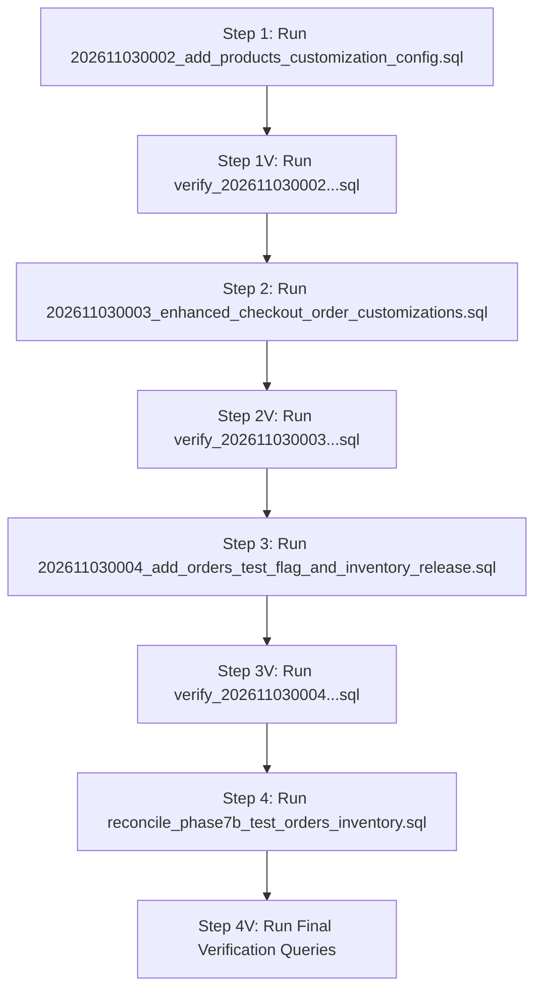

# CALVIN AATAMAKER — Phase 7B Final Migration Preflight Guide

**Document Date:** November 4, 2026  
**Auditor:** Senior Software & Database Engineering Specialist  
**Target Database:** Live Supabase PostgreSQL  
**Target Product ID:** `327d5d70-ec43-4d28-9aff-cd1de77a23c5` (*Compact Domestic Aatamaker*)  
**Status:** 100% Pre-Flight Verified — Ready for Manual Application in Supabase SQL Editor  

---

## Executive Summary & Strict Constraints

This preflight guide provides the exact, copy-pasteable execution roadmap for applying the three Phase 7B database migrations and the final guarded inventory reconciliation transaction in the Supabase SQL Editor.

### Invariants Maintained
1. **Current Live Stock:** Verified at **94 units**.
2. **Historical Deductions:** Exactly **6 units** were deducted by 5 development test orders (`CA-120A39C5E1`, `CA-FE9C311C5A`, `CA-35C3C3A849`, `CA-70F00BBF32`, `CA-MTC84MQF84`).
3. **Seed Order CA-7891F04B40:** Seeded on October 27, 2026. It did **not** deduct stock from the 94 units and is marked `inventory_deducted = false` without populating a fake `inventory_released_at` timestamp.
4. **Final Target Stock:** Exactly **100 units** ($94 + 6 = 100$).
5. **No Double Release:** All 5 development test orders are permanently set to `cancelled` and `inventory_released_at = now()`.
6. **Deadlock Prevention:** The reconciliation transaction strictly locks `public.orders` rows FIRST, matching the lock acquisition order of `cancel_order_and_release_inventory()`, before locking `public.products` row SECOND.

---

## 1. Exact Execution Order & Pipeline

Execute these steps sequentially in the **Supabase Dashboard $\to$ SQL Editor**:



---

## 2. Step-by-Step Instructions & SQL Scripts

### STEP 1: Apply Migration 202611030002
**File:** `supabase/migrations/202611030002_add_products_customization_config.sql`  
**Purpose:** Adds the additive `customization_config` JSONB column with schema constraint and demonstration backfill for customizable products.

```sql
BEGIN;

-- 1. Additive column on public.products
ALTER TABLE public.products 
ADD COLUMN IF NOT EXISTS customization_config jsonb DEFAULT NULL;

-- 2. Validate JSON structure (must be an object if not null)
DO $$
BEGIN
  IF NOT EXISTS (
    SELECT 1 
    FROM pg_constraint 
    WHERE conname = 'chk_products_customization_config_object'
      AND conrelid = 'public.products'::regclass
  ) THEN
    ALTER TABLE public.products
    ADD CONSTRAINT chk_products_customization_config_object
    CHECK (customization_config IS NULL OR jsonb_typeof(customization_config) = 'object');
  END IF;
END $$;

-- 3. Column documentation
COMMENT ON COLUMN public.products.customization_config IS 
'Configurable personalization schema defining supported fields, upload rules, 3D model linkage, layer limits, and price deltas.';

-- 4. Backward-compatible backfill for existing customizable products
UPDATE public.products
SET customization_config = jsonb_build_object(
  'enabled', true,
  'mode', 'demonstration',
  'model_id', null,
  'surface_id', null,
  'allow_photo_upload', true,
  'allow_text_tools', true,
  'max_photo_size_mb', 10,
  'allowed_photo_types', jsonb_build_array('image/jpeg', 'image/png', 'image/webp'),
  'max_text_layers', 5,
  'allowed_fonts', jsonb_build_array('serif', 'sans-serif', 'display', 'script'),
  'base_customization_price', 0,
  'fields', jsonb_build_array(
    jsonb_build_object(
      'id', 'front_panel_finish',
      'type', 'swatch',
      'label', 'Cabinet Door & Panel Finish',
      'help_text', 'Select handcrafted timber veneer or architectural matte finish.',
      'required', true,
      'options', jsonb_build_array(
        jsonb_build_object('id', 'opt_matte_black', 'value', 'matte_black', 'label', 'Midnight Matte Charcoal', 'price_delta', 0, 'swatch_color', '#18181C'),
        jsonb_build_object('id', 'opt_teak_grain', 'value', 'teak_grain', 'label', 'Natural Warm Teak', 'price_delta', 1500, 'swatch_color', '#8B4513'),
        jsonb_build_object('id', 'opt_royal_walnut', 'value', 'royal_walnut', 'label', 'Royal Dark Walnut', 'price_delta', 2200, 'swatch_color', '#4A2E18'),
        jsonb_build_object('id', 'opt_brushed_brass', 'value', 'brushed_brass', 'label', 'Champagne Brushed Metallic', 'price_delta', 3500, 'swatch_color', '#D4AF37')
      )
    ),
    jsonb_build_object(
      'id', 'sieve_mesh_grade',
      'type', 'select',
      'label', 'Specialized Flour Mesh Kit',
      'help_text', 'Included stone-grinding sieve assortment for different grains.',
      'required', true,
      'options', jsonb_build_array(
        jsonb_build_object('id', 'opt_std_sieve', 'value', 'standard_assortment', 'label', 'Complete 7-Sieve Domestic Kit (Standard)', 'price_delta', 0),
        jsonb_build_object('id', 'opt_micro_sieve', 'value', 'micro_flour_sieve', 'label', 'Ultra-Fine Bakery & Gluten-Free Sieve Kit', 'price_delta', 750),
        jsonb_build_object('id', 'opt_heavy_millets', 'value', 'millets_multi_grain', 'label', 'Coarse Millets & Multi-Grain Grinding Kit', 'price_delta', 850)
      )
    ),
    jsonb_build_object(
      'id', 'family_name_engraving',
      'type', 'text',
      'label', 'Bespoke Brass Door Inscription',
      'help_text', 'Custom family name or kitchen inscription (up to 30 characters).',
      'required', false,
      'max_length', 30
    )
  )
)
WHERE is_customisable = true 
  AND customization_config IS NULL;

COMMIT;
```

#### Verification for Step 1:
Run `supabase/migrations/verify_202611030002_add_products_customization_config.sql`.  
**Expected Result:** Column exists, constraint `chk_products_customization_config_object` is present, and customizable products show `config_enabled = 'true'`.

---

### STEP 2: Apply Migration 202611030003
**File:** `supabase/migrations/202611030003_enhanced_checkout_order_customizations.sql`  
**Purpose:** Upgrades `create_checkout_order()` RPC to validate customization price deltas, mixed cart items, multi-variant stock, and atomic order creation.

*(Copy full contents of `supabase/migrations/202611030003_enhanced_checkout_order_customizations.sql` into SQL Editor and run).*

#### Verification for Step 2:
Run `supabase/migrations/verify_202611030003_enhanced_checkout_order_customizations.sql`.  
**Expected Result:** Notice: `SUCCESS: public.create_checkout_order passes all security and integrity checks.`

---

### STEP 3: Apply Migration 202611030004
**File:** `supabase/migrations/202611030004_add_orders_test_flag_and_inventory_release.sql`  
**Purpose:** Adds `is_test_order`, `inventory_released_at`, and `inventory_deducted` columns to `public.orders`, backfills the 6 verified test orders, and establishes the atomic `cancel_order_and_release_inventory()` RPC.

```sql
BEGIN;

-- 1. Additive columns on public.orders
ALTER TABLE public.orders 
ADD COLUMN IF NOT EXISTS is_test_order boolean NOT NULL DEFAULT false;

ALTER TABLE public.orders 
ADD COLUMN IF NOT EXISTS inventory_released_at timestamptz DEFAULT NULL;

ALTER TABLE public.orders 
ADD COLUMN IF NOT EXISTS inventory_deducted boolean NOT NULL DEFAULT true;

COMMENT ON COLUMN public.orders.is_test_order IS 
'Flags orders created during development, automated testing, or staging verification. Test orders can never be confirmed, processed, shipped, or delivered.';

COMMENT ON COLUMN public.orders.inventory_released_at IS 
'Timestamp when reserved inventory was restored following order cancellation or expiration. Prevents duplicate inventory release.';

COMMENT ON COLUMN public.orders.inventory_deducted IS 
'Flags whether physical inventory was deducted when this order was created. Seed orders that bypassed stock decrement have inventory_deducted = false and are exempt from stock restoration.';

-- 2. Backfill known verified development orders
UPDATE public.orders
SET is_test_order = true
WHERE order_number IN (
  'CA-7891F04B40',
  'CA-120A39C5E1',
  'CA-FE9C311C5A',
  'CA-35C3C3A849',
  'CA-70F00BBF32',
  'CA-MTC84MQF84'
);

-- Mark seed order as exempt from inventory deduction (stock was never deducted for it)
UPDATE public.orders
SET inventory_deducted = false
WHERE order_number = 'CA-7891F04B40';

-- 3. Atomic Order Cancellation & Inventory Release RPC
CREATE OR REPLACE FUNCTION public.cancel_order_and_release_inventory(
  p_order_id uuid
)
RETURNS jsonb
LANGUAGE plpgsql
SECURITY DEFINER
SET search_path = public, pg_temp
AS $$
DECLARE
  v_order record;
  v_item record;
  v_prod_id uuid;
  v_var_id uuid;
  v_qty integer;
  v_already_released boolean := false;
  v_restored_lines integer := 0;
BEGIN
  -- Verify order existence and lock row for update
  SELECT id, order_number, order_status, inventory_released_at, is_test_order, inventory_deducted
  INTO v_order
  FROM public.orders
  WHERE id = p_order_id
  FOR UPDATE;

  IF NOT FOUND THEN
    RAISE EXCEPTION 'ORDER_NOT_FOUND: Order (%) does not exist.', p_order_id;
  END IF;

  -- Idempotency check: if already cancelled and inventory released, return immediately
  IF v_order.inventory_released_at IS NOT NULL OR v_order.order_status = 'cancelled' THEN
    RETURN jsonb_build_object(
      'success', true,
      'order_id', v_order.id,
      'order_number', v_order.order_number,
      'already_released', true,
      'restored_lines', 0,
      'message', 'Order is already cancelled and inventory was previously released.'
    );
  END IF;

  -- If inventory was never deducted (e.g. historical seed order CA-7891F04B40),
  -- cancel the order without modifying catalog stock
  IF NOT v_order.inventory_deducted THEN
    UPDATE public.orders
    SET order_status = 'cancelled',
        updated_at = pg_catalog.now()
    WHERE id = p_order_id;

    RETURN jsonb_build_object(
      'success', true,
      'order_id', v_order.id,
      'order_number', v_order.order_number,
      'already_released', false,
      'restored_lines', 0,
      'message', 'Order cancelled. Inventory was never deducted (exempt from restoration).'
    );
  END IF;

  -- 1. Update order status and set inventory release timestamp
  UPDATE public.orders
  SET order_status = 'cancelled',
      inventory_released_at = pg_catalog.now(),
      updated_at = pg_catalog.now()
  WHERE id = p_order_id;

  -- 2. Aggregate line item quantities and restore stock
  FOR v_item IN
    SELECT product_id, variant_id, sum(quantity)::integer AS total_qty
    FROM public.order_items
    WHERE order_id = p_order_id
    GROUP BY product_id, variant_id
  LOOP
    IF v_item.variant_id IS NOT NULL THEN
      UPDATE public.product_variants
      SET stock_quantity = stock_quantity + v_item.total_qty,
          updated_at = pg_catalog.now()
      WHERE id = v_item.variant_id;
    ELSIF v_item.product_id IS NOT NULL THEN
      UPDATE public.products
      SET stock_quantity = stock_quantity + v_item.total_qty,
          updated_at = pg_catalog.now()
      WHERE id = v_item.product_id;
    END IF;

    v_restored_lines := v_restored_lines + 1;
  END LOOP;

  RETURN jsonb_build_object(
    'success', true,
    'order_id', v_order.id,
    'order_number', v_order.order_number,
    'already_released', false,
    'restored_lines', v_restored_lines,
    'message', 'Order cancelled and reserved stock restored successfully.'
  );
END;
$$;

-- Secure execution privileges
REVOKE EXECUTE ON FUNCTION public.cancel_order_and_release_inventory FROM PUBLIC, anon, authenticated;
GRANT EXECUTE ON FUNCTION public.cancel_order_and_release_inventory TO service_role;

COMMIT;
```

#### Verification for Step 3:
Run `supabase/migrations/verify_202611030004_add_orders_test_flag_and_inventory_release.sql`.  
**Expected Result:** Notice: `SUCCESS: Migration 202611030004 verified successfully.`

---

### STEP 4: Apply Final Guarded Reconciliation Transaction
**File:** `supabase/migrations/reconcile_phase7b_test_orders_inventory.sql`  
**Purpose:** Locks 5 test orders FIRST, target product SECOND, enforces 17 integrity checks, restores 6 units ($94 \to 100$), marks the 5 test orders cancelled & released, and ensures seed order has `inventory_deducted = false` without a fake release timestamp.

```sql
DO $$
DECLARE
  v_target_product_id CONSTANT uuid := '327d5d70-ec43-4d28-9aff-cd1de77a23c5';
  v_prod record;
  v_test_order_count integer := 0;
  v_non_test_count integer := 0;
  v_invalid_status_count integer := 0;
  v_invalid_pay_count integer := 0;
  v_already_released_count integer := 0;
  v_calculated_qty integer := 0;
  v_updated_prod_count integer := 0;
  v_updated_orders_count integer := 0;
  v_seed_order record;
BEGIN
  -- ----------------------------------------------------------------------------
  -- Step 1: LOCK ALL FIVE DEVELOPMENT ORDER ROWS (Orders Locked FIRST)
  -- ----------------------------------------------------------------------------
  PERFORM id
  FROM public.orders
  WHERE order_number IN (
    'CA-120A39C5E1',
    'CA-FE9C311C5A',
    'CA-35C3C3A849',
    'CA-70F00BBF32',
    'CA-MTC84MQF84'
  )
  FOR UPDATE;

  -- Step 2: Verify exactly five expected development orders exist
  SELECT count(*)
  INTO v_test_order_count
  FROM public.orders
  WHERE order_number IN (
    'CA-120A39C5E1',
    'CA-FE9C311C5A',
    'CA-35C3C3A849',
    'CA-70F00BBF32',
    'CA-MTC84MQF84'
  );

  IF v_test_order_count <> 5 THEN
    RAISE EXCEPTION 'RECONCILIATION_ABORTED: Expected 5 development test orders, found %.', v_test_order_count;
  END IF;

  -- ----------------------------------------------------------------------------
  -- Step 3: VERIFY ALL FIVE HAVE is_test_order = true
  -- ----------------------------------------------------------------------------
  SELECT count(*)
  INTO v_non_test_count
  FROM public.orders
  WHERE order_number IN (
    'CA-120A39C5E1',
    'CA-FE9C311C5A',
    'CA-35C3C3A849',
    'CA-70F00BBF32',
    'CA-MTC84MQF84'
  ) AND is_test_order <> true;

  IF v_non_test_count > 0 THEN
    RAISE EXCEPTION 'RECONCILIATION_ABORTED: % development order(s) are not flagged with is_test_order = true.', v_non_test_count;
  END IF;

  -- ----------------------------------------------------------------------------
  -- Step 4: VERIFY ALL FIVE REMAIN pending
  -- ----------------------------------------------------------------------------
  SELECT count(*)
  INTO v_invalid_status_count
  FROM public.orders
  WHERE order_number IN (
    'CA-120A39C5E1',
    'CA-FE9C311C5A',
    'CA-35C3C3A849',
    'CA-70F00BBF32',
    'CA-MTC84MQF84'
  ) AND order_status <> 'pending';

  IF v_invalid_status_count > 0 THEN
    RAISE EXCEPTION 'RECONCILIATION_ABORTED: % development order(s) are not in pending status.', v_invalid_status_count;
  END IF;

  -- ----------------------------------------------------------------------------
  -- Step 5: VERIFY ALL FIVE REMAIN UNPAID
  -- ----------------------------------------------------------------------------
  SELECT count(*)
  INTO v_invalid_pay_count
  FROM public.orders
  WHERE order_number IN (
    'CA-120A39C5E1',
    'CA-FE9C311C5A',
    'CA-35C3C3A849',
    'CA-70F00BBF32',
    'CA-MTC84MQF84'
  ) AND payment_status <> 'pending';

  IF v_invalid_pay_count > 0 THEN
    RAISE EXCEPTION 'RECONCILIATION_ABORTED: % development order(s) are not in pending payment status.', v_invalid_pay_count;
  END IF;

  -- ----------------------------------------------------------------------------
  -- Step 6: VERIFY NO TEST ORDER HAS ALREADY RELEASED INVENTORY
  -- ----------------------------------------------------------------------------
  SELECT count(*)
  INTO v_already_released_count
  FROM public.orders
  WHERE order_number IN (
    'CA-120A39C5E1',
    'CA-FE9C311C5A',
    'CA-35C3C3A849',
    'CA-70F00BBF32',
    'CA-MTC84MQF84'
  ) AND inventory_released_at IS NOT NULL;

  IF v_already_released_count > 0 THEN
    RAISE EXCEPTION 'RECONCILIATION_ABORTED: % development order(s) already have inventory_released_at populated.', v_already_released_count;
  END IF;

  -- ----------------------------------------------------------------------------
  -- Step 7 & 8: LOCK TARGET PRODUCT ROW & VERIFY CURRENT STOCK IS EXACTLY 94 (Product Locked SECOND)
  -- ----------------------------------------------------------------------------
  SELECT id, name, stock_quantity
  INTO v_prod
  FROM public.products
  WHERE id = v_target_product_id
  FOR UPDATE;

  IF NOT FOUND THEN
    RAISE EXCEPTION 'RECONCILIATION_ABORTED: Target product (%) does not exist.', v_target_product_id;
  END IF;

  IF v_prod.stock_quantity <> 94 THEN
    RAISE EXCEPTION 'RECONCILIATION_ABORTED: Target product stock is %, expected exactly 94. Aborting to prevent inventory corruption.', v_prod.stock_quantity;
  END IF;

  -- ----------------------------------------------------------------------------
  -- Step 9 & 10: CALCULATE ACTUAL QUANTITY & VERIFY IT IS EXACTLY 6 UNITS
  -- ----------------------------------------------------------------------------
  SELECT COALESCE(sum(oi.quantity), 0)
  INTO v_calculated_qty
  FROM public.order_items oi
  JOIN public.orders o ON o.id = oi.order_id
  WHERE o.order_number IN (
    'CA-120A39C5E1',
    'CA-FE9C311C5A',
    'CA-35C3C3A849',
    'CA-70F00BBF32',
    'CA-MTC84MQF84'
  ) AND oi.product_id = v_target_product_id;

  IF v_calculated_qty <> 6 THEN
    RAISE EXCEPTION 'RECONCILIATION_ABORTED: Calculated deducted quantity is %, expected exactly 6 units.', v_calculated_qty;
  END IF;

  -- ----------------------------------------------------------------------------
  -- Step 11 & 12: RESTORE SIX UNITS & VERIFY EXACTLY ONE PRODUCT ROW UPDATED
  -- ----------------------------------------------------------------------------
  UPDATE public.products
  SET stock_quantity = stock_quantity + 6,
      updated_at = pg_catalog.now()
  WHERE id = v_target_product_id
    AND stock_quantity = 94;

  GET DIAGNOSTICS v_updated_prod_count = ROW_COUNT;
  IF v_updated_prod_count <> 1 THEN
    RAISE EXCEPTION 'RECONCILIATION_ABORTED: Failed to update target product (rows updated: %, expected 1).', v_updated_prod_count;
  END IF;

  -- ----------------------------------------------------------------------------
  -- Step 13 & 14: MARK 5 TEST ORDERS CANCELLED & RELEASED, VERIFY 5 ROWS UPDATED
  -- ----------------------------------------------------------------------------
  UPDATE public.orders
  SET order_status = 'cancelled',
      inventory_released_at = pg_catalog.now(),
      updated_at = pg_catalog.now()
  WHERE order_number IN (
    'CA-120A39C5E1',
    'CA-FE9C311C5A',
    'CA-35C3C3A849',
    'CA-70F00BBF32',
    'CA-MTC84MQF84'
  ) AND inventory_released_at IS NULL;

  GET DIAGNOSTICS v_updated_orders_count = ROW_COUNT;
  IF v_updated_orders_count <> 5 THEN
    RAISE EXCEPTION 'RECONCILIATION_ABORTED: Failed to update test orders (rows updated: %, expected 5).', v_updated_orders_count;
  END IF;

  -- ----------------------------------------------------------------------------
  -- Step 15 & 16: HANDLE SEED ORDER CA-7891F04B40 SEPARATELY (EXEMPT FROM RELEASE)
  -- ----------------------------------------------------------------------------
  SELECT id, order_number, order_status, is_test_order, inventory_deducted, inventory_released_at
  INTO v_seed_order
  FROM public.orders
  WHERE order_number = 'CA-7891F04B40'
  FOR UPDATE;

  IF FOUND THEN
    -- Ensure seed order is explicitly marked as exempt from stock deduction/restoration
    -- without populating a misleading inventory_released_at timestamp
    UPDATE public.orders
    SET is_test_order = true,
        inventory_deducted = false,
        updated_at = pg_catalog.now()
    WHERE id = v_seed_order.id;
  END IF;

  -- ----------------------------------------------------------------------------
  -- Step 17: COMPLETE VALIDATION & SUCCESS NOTICE
  -- ----------------------------------------------------------------------------
  RAISE NOTICE 'SUCCESS: Reconciled 6 units of stock for % (stock restored from 94 to 100). All 5 development test orders cancelled and released.', v_prod.name;
END $$;
```

---

## 3. Post-Reconciliation Verification Queries (Step 4V)

Run these queries in Supabase SQL Editor after Step 4:

```sql
-- 1. Verify Target Product Stock is Exactly 100
SELECT id, name, stock_quantity, updated_at
FROM public.products
WHERE id = '327d5d70-ec43-4d28-9aff-cd1de77a23c5';
-- Expected: stock_quantity = 100

-- 2. Verify 5 Test Orders are Cancelled and Inventory Released
SELECT order_number, order_status, payment_status, is_test_order, inventory_deducted, inventory_released_at
FROM public.orders
WHERE order_number IN (
  'CA-120A39C5E1',
  'CA-FE9C311C5A',
  'CA-35C3C3A849',
  'CA-70F00BBF32',
  'CA-MTC84MQF84'
)
ORDER BY created_at ASC;
-- Expected:
--   order_status = 'cancelled'
--   is_test_order = true
--   inventory_deducted = true
--   inventory_released_at IS NOT NULL (populated with current timestamp)

-- 3. Verify Seed Order CA-7891F04B40 is Handled Accurately
SELECT order_number, order_status, is_test_order, inventory_deducted, inventory_released_at
FROM public.orders
WHERE order_number = 'CA-7891F04B40';
-- Expected:
--   is_test_order = true
--   inventory_deducted = false
--   inventory_released_at IS NULL (no fake release timestamp)
```

